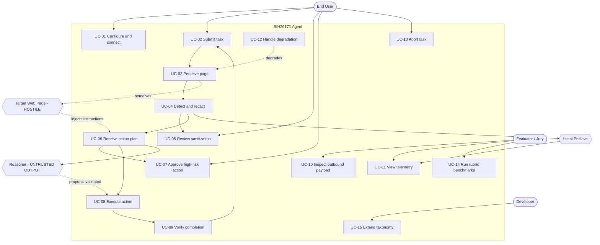

# USE-CASE MODEL

| Field | Value |
|---|---|
| Document ID | `REQ-UC-001` |
| Version | 1.0 — Draft for approval |
| Status | 🟡 **Complete — awaiting Product Owner approval** |
| Owner | Technical Lead |
| Traces to | `REQ-SRS-001` (102 functional requirements) |
| Traced by | `REQ-RTM-001` |

---

## 1. Purpose and scope

This document describes the system's behaviour **from the outside** — who uses it, what goals they
pursue, and what the system does to satisfy those goals. It complements `REQ-SRS-001`: the SRS
states what the system *must do*; this model states *who wants it and why*, with flows a reviewer
or jury can follow without reading source code.

---

## 2. Actors

### 2.1 Primary actors — those who initiate use cases

| Actor | Goal | Frequency |
|---|---|---|
| **End User** | Complete a web task without exposing sensitive data | Every task |
| **SIH Evaluator / Jury** | Verify the privacy claim and score the five rubric weights | During evaluation |
| **Developer / Maintainer** | Add entity types and detectors without editing existing modules | Occasional |

### 2.2 Supporting actors — systems the product depends on

| Actor | Role | Trust posture |
|---|---|---|
| **Browser (Chrome MV3)** | Hosts the extension; supplies DOM, tab lifecycle, and capture APIs | Trusted platform |
| **Reasoner** | Produces action proposals. Selected at runtime: on-device model → local enclave → external provider | **Untrusted output** — proposals are validated, never obeyed |
| **Local Reasoning Enclave** | Loopback-only service providing reasoning, policy authority, verification | Semi-trusted |

### 2.3 The adversarial actor — an explicit design decision

| Actor | Intent |
|---|---|
| **Target Web Page** | **Untrusted. May be actively hostile.** |

The target page is modelled as an **actor**, not as passive data. This is deliberate: PS171
concerns pages holding government, banking, and healthcare data — exactly where an attacker would
attempt **indirect prompt injection**, embedding instructions in page text, attributes, or
accessible names to manipulate the agent.

Treating the page as a hostile actor is what makes `FR-POL-6` (untrusted content cannot influence
policy) a first-class requirement rather than an afterthought.

---

## 3. Use-case overview

**Reading note.** The two dashed edges from `PG` and `RZ` are the security-critical ones. The page
*injects*, and the reasoner *proposes* — **neither decides**. Every decision edge terminates inside
the system, never in an external actor. That asymmetry is the architecture.

## 4. Use-case catalogue

| ID | Use case | Primary actor | Priority | Key requirements |
|---|---|---|---|---|
| `UC-01` | Configure and connect | End User | Must | `EI-3`, `EI-4`, `FR-CAP-1` |
| `UC-02` | Submit a task | End User | Must | `FR-AGT-1`, `FR-AGT-3` |
| `UC-03` | Perceive the current page | System | Must | `FR-PER-1`…`7`, `FR-VIS-1`…`7` |
| `UC-04` | Detect and redact sensitive data | System | Must | `FR-PII-1`…`12`, `FR-RED-1`…`8` |
| `UC-05` | Review sanitization result | End User | Must | `FR-VLT-6`, `FR-UI-3` |
| `UC-06` | Receive an action plan | System | Must | `FR-AGT-4`, `FR-AGT-5` |
| `UC-07` | Approve a high-risk action | End User | Must | `FR-POL-3`, `FR-EXE-2`, `FR-UI-7` |
| `UC-08` | Execute a browser action | System | Must | `FR-EXE-1`…`6` |
| `UC-09` | Verify task completion | System | Must | `FR-VER-1`…`5` |
| `UC-10` | Inspect the outbound payload | Evaluator | Must | `FR-EGR-6`, `FR-UI-5` |
| `UC-11` | View privacy and telemetry | Evaluator | Must | `FR-TEL-1`…`9`, `FR-UI-4` |
| `UC-12` | Handle capability degradation | System | Must | `FR-CAP-1`…`4`, `FR-CAP-7` |
| `UC-13` | Abort a running task | End User | Must | `FR-AGT-7` |
| `UC-14` | Run the rubric benchmarks | Evaluator | Must | `FR-TEL-5`, `FR-TEL-6` |
| `UC-15` | Extend the entity taxonomy | Developer | Should | `REQ-DATA-001` D-1…D-4, X-1…X-5 |
| `UC-16` | Rebind to fresh observation | System | Must | `FR-AGT-5` |

### 4.1 Include and extend relationships

| Relationship | From → To | Condition |
|---|---|---|
| `<<include>>` | `UC-03` → `UC-12` | Always — capability resolution precedes every perception |
| `<<include>>` | `UC-04` → `UC-03` | Always — detection has nothing to act on without perception |
| `<<include>>` | `UC-08` → `UC-16` | Always — no action executes against a stale observation |
| `<<include>>` | `UC-08` → `UC-04` | Always — post-action re-perception is sanitized before the next step |
| `<<extend>>` | `UC-07` → `UC-08` | Only when the policy decision is `CONFIRM` |
| `<<extend>>` | `UC-13` → any running use case | Only on user abort or origin navigation |
| `<<extend>>` | `UC-12` → `UC-03` | Only when the preferred capability rung is unavailable |

---

## 5. Detailed use-case specifications

### UC-04 — Detect and redact sensitive data

| Field | Value |
|---|---|
| **Primary actor** | System (invoked by `UC-03`) |
| **Stakeholders** | End User (no disclosure) · Evaluator (measurable precision and recall) |
| **Preconditions** | A perception result exists and carries an observation identifier |
| **Trigger** | Perception completes |
| **Success postcondition** | Sanitized artefact emitted with state `SANITIZED`; vault updated **in memory only** |
| **Failure postcondition** | State is `DEGRADED`, `UNCERTAIN`, or `NOT_INSTRUMENTED`; context withheld or fail-closed redacted |

**Main success scenario**

1. System loads the entity registry from the generated taxonomy.
2. System normalises each candidate span (`REQ-DATA-001` N-1…N-4).
3. For each candidate, system applies the verification tier for its entity — `T1` checksum,
   `T2` structure, `T3` context, `T4` classifier confidence.
4. System applies context gating for `T3` entities within a bounded local window.
5. System resolves accepted findings into placeholders and updates the in-memory vault.
6. System applies redaction to both text spans and pixel regions.
7. System **independently re-inspects** the redacted artefact (`FR-RED-4`).
8. System sets state to `SANITIZED` and emits the sanitized artefact.

**Alternate flows**

| Step | Condition | Handling |
|---|---|---|
| 3a | Checksum fails (Luhn / Verhoeff) | **Discard** the finding. Never downgrade to a lower-confidence positive. |
| 3b | Validator raises an error | Emit `NOT_INSTRUMENTED`; fail closed. |
| 4a | Context cue absent | Mark `UNCERTAIN`; **still redact** (`FR-PII-9`). |
| 5a | Placeholder collides with existing page text | Offset the placeholder namespace (`REQ-DATA-001` P-6). |
| 6a | Password-type field | Redact unconditionally, without requiring a pattern match. |
| 7a | Re-inspection finds residual content | **Discard the artefact**; emit `DEGRADED`; do not transmit. |
| 7b | Re-inspection cannot run at all | Emit `NOT_INSTRUMENTED`; withhold the context entirely. |

> **Step 7 is the requirement that closes the v1 defect.** Without it, a failed redaction is
> indistinguishable from a successful one — which is precisely how v1 shipped a 1×1 image flagged
> `is_sanitized: true`.

### UC-08 — Execute a browser action

| Field | Value |
|---|---|
| **Primary actor** | System |
| **Stakeholders** | End User (nothing unintended happens) · Evaluator (unauthorised-execution rate = 0) |
| **Preconditions** | Action is structurally valid; a policy decision exists; a fresh observation is available |
| **Trigger** | A decision of `ALLOW`, or a valid approval token following `CONFIRM` |
| **Success postcondition** | Action applied to exactly its bound target; outcome recorded; loop re-perceived |
| **Failure postcondition** | No dispatch occurs, or a dispatch fails explicitly and is reported as failure (never success) |

**Main success scenario**

1. Receive a validated action together with its policy decision and observation identifier.
2. **Rebind** the target against the fresh observation (`UC-16`).
3. Verify the decision. Where it is `CONFIRM`, validate the approval token — signature, expiry,
   and binding to this specific action, target, and origin.
4. Confirm the action type belongs to the declared allowlist.
5. Dispatch the action to the browser.
6. Bound execution in time and record the observed outcome.
7. Trigger re-perception and re-sanitization (`UC-03` → `UC-04`) before the next reasoning step.

**Alternate flows**

| Step | Condition | Handling |
|---|---|---|
| 2a | Target absent from the fresh observation | **Reject** the action, audit the rejection, never dispatch (`FR-AGT-5`). |
| 3a | Decision is `BLOCK` | Halt the task. The executor is never invoked (`FR-POL-4`). |
| 3b | `CONFIRM` but no token, mismatched token, or expired token | Refuse execution (`FR-EXE-2`). |
| 4a | Action type outside the allowlist | Structurally unreachable — no dispatch path exists. |
| 6a | Execution times out | Report an **explicit failure**. A timeout is never rendered as success (`FR-EXE-4`). |

> **Steps 2 and 3 are the two independent guards.** Step 2 defends against the page mutating
> between planning and acting ("stale target"). Step 3 defends against acting without authority.
> Neither alone is sufficient, which is why both are `Must`.

### UC-12 — Handle capability degradation

| Field | Value |
|---|---|
| **Primary actor** | System (included by `UC-03`) |
| **Stakeholders** | End User (system keeps working) · Evaluator (resource weight, honest reporting) |
| **Preconditions** | None — this use case exists precisely for hosts that lack the preferred capability |
| **Trigger** | A perception or inference request, or a change in execution context |
| **Success postcondition** | An available rung is selected and recorded; the system continues operating |
| **Failure postcondition** | No rung can sanitize → `NOT_INSTRUMENTED`, context withheld |

**Main success scenario**

1. Probe the ladder in order: **WebGPU → WASM SIMD → WASM → DOM-only**.
2. Select the first rung that reports available.
3. Record the active rung in telemetry and expose it in the interface (`FR-CAP-2`).
4. Compare the active rung against the preferred rung.
5. If the active rung is below preferred, declare `DEGRADED` on every artefact subsequently produced.
6. Continue operating with declared reduced capability.

**Alternate flows**

| Step | Condition | Handling |
|---|---|---|
| 1a | WebGPU absent | Fall through to WASM SIMD. **This is the expected path on evaluator hardware** (`C-4`: no GPU assumed). |
| 1b | A probe itself errors | Treat that rung as unavailable, continue to the next, record the probe error. |
| 2a | No rung can perform sanitization | Emit `NOT_INSTRUMENTED` and withhold the context. **No artefact may assert `SANITIZED`** (`FR-CAP-4`). |
| 4a | Active rung equals preferred | Normal operation; no `DEGRADED` declaration. |

> **Why this is a `Must`, not a nice-to-have.** In v1 the equivalent path produced a 1×1 transparent
> image carrying `is_sanitized: true` — a total failure that looked like success. Degradation is
> therefore modelled as a **first-class, declared, visible outcome**, not an error handler.

---

## 6. Use-case traceability

| Trace | Destination |
|---|---|
| Use cases → requirements | §4 catalogue, and `REQ-RTM-001` |
| Requirements → rubric weights | `REQ-SRS-001` §2.2 and §5.1 |
| Use cases → design | `DES-ARCH-001`, `DES-CLASS-001`, `DES-SEQ-001` |
| Use cases → verification | `QUA-TSTG-001` (test strategy), `QUA-BENCH-001` (benchmark protocol) |

### 6.1 Coverage

| Metric | Value |
|---|---|
| Use cases | 16 |
| Primary actors | 3 |
| Supporting actors | 3 |
| Adversarial actors | 1 (Target Web Page) |
| `<<include>>` relationships | 4 |
| `<<extend>>` relationships | 3 |
| Detail-specified | 3 of 16 (`UC-04`, `UC-08`, `UC-12`) |

> **On the three detailed specifications.** `UC-04` (detect and redact), `UC-08` (execute) and
> `UC-12` (degrade) are specified with full main and alternate flows because they carry the
> security and correctness risk. The remaining use cases are ordinary CRUD-shaped interactions
> whose behaviour is fully determined by their requirement rows. Detailing them would add volume
> without adding information — reachability will be proven instead by the sequence diagrams in
> `DES-SEQ-001`.

*End of `REQ-UC-001`.*