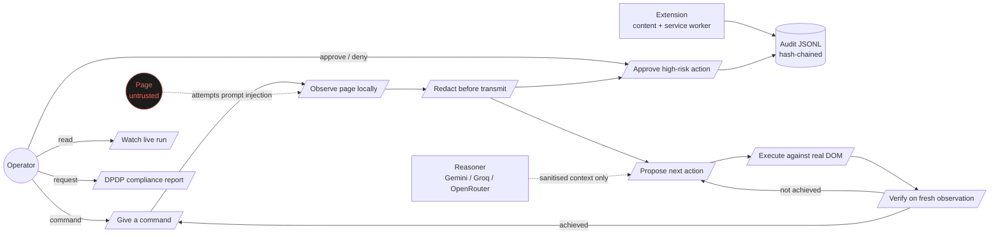
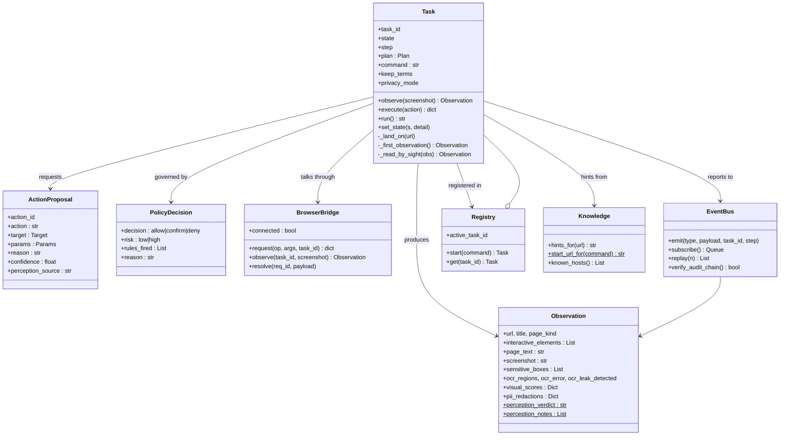
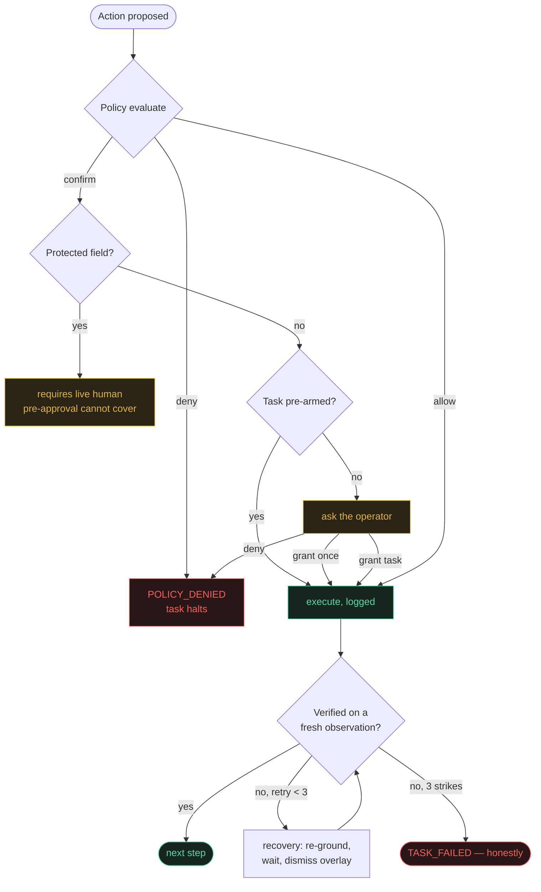
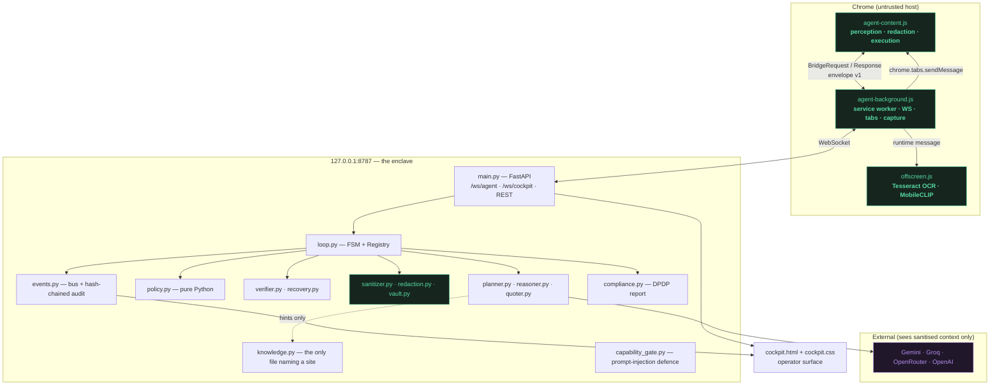
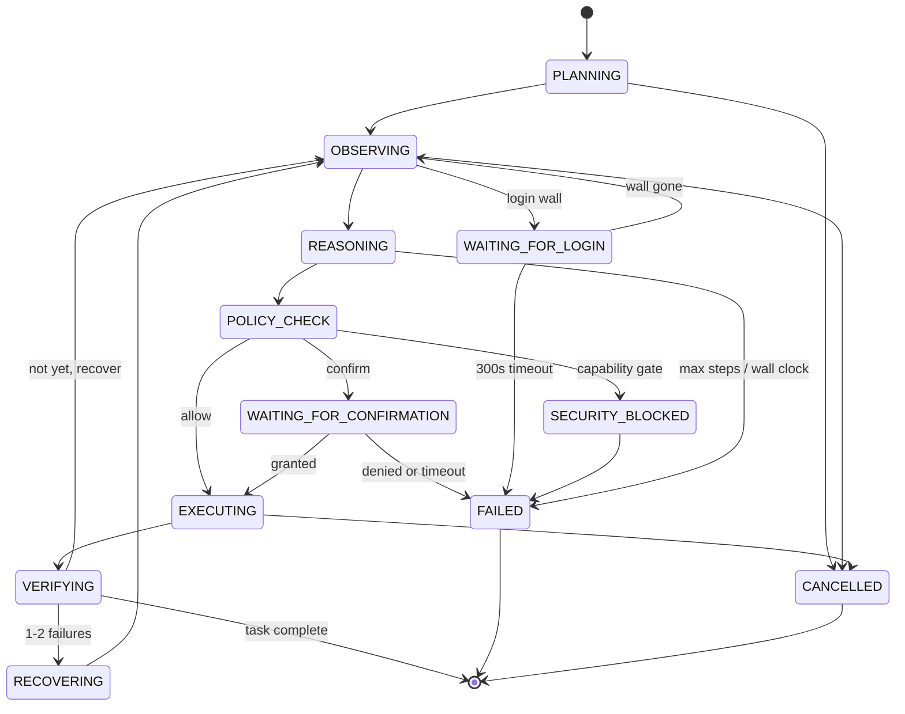
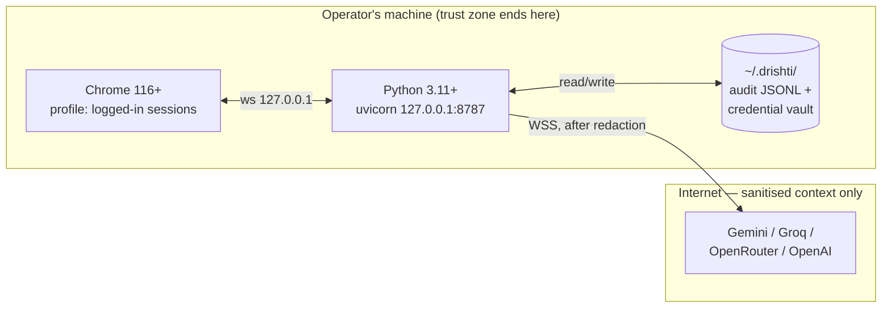
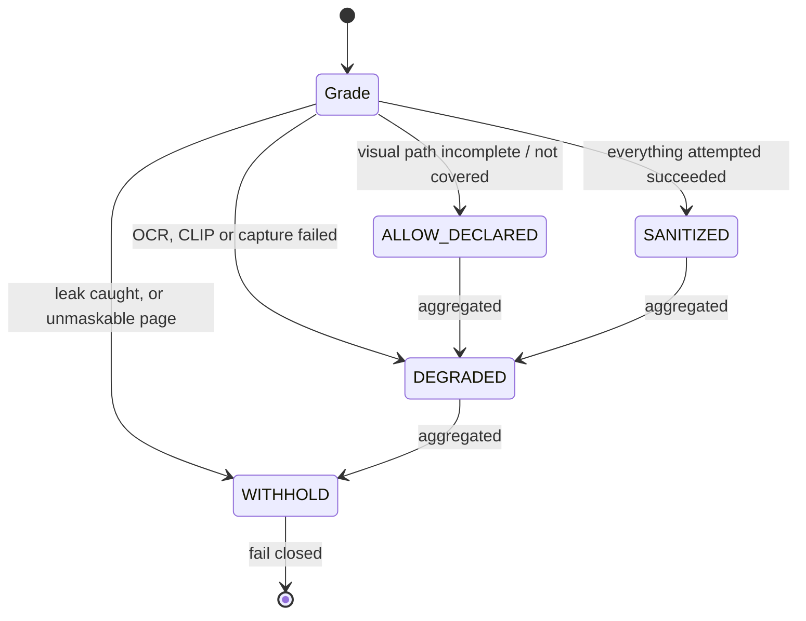

# Drishti — UML Diagram Set

All diagrams are Mermaid, renderable in GitHub, VS Code and most Markdown
viewers. Each is derived from shipped code; the source file is named beneath
each diagram so a reviewer can check it.

---

## 1. Use-case diagram

Actors are the five in the SRS. Note that **Page** is drawn as an actor because
it is untrusted and actively attempts injection — it is not a participant the
system trusts.



**Source:** `server/loop.py` (FSM), `server/policy.py` (UC4 branch).

---

## 2. Class diagram — server core



**Source:** `server/schemas.py`, `server/loop.py`, `server/browser_bridge.py`,
`server/events.py`, `server/knowledge.py`.

---

## 3. Sequence — one closed-loop step

This is the diagram that matters most: it shows that **verification reads a
fresh observation**, not the one the action was planned against.

```mermaid
sequenceDiagram
  autonumber
  participant C as Cockpit
  participant L as Loop / Task
  participant B as BrowserBridge
  participant X as Extension
  participant R as Reasoner (cloud)
  participant P as Policy (pure Python)

  C->>L: TASK_CREATE
  L->>R: plan(command)
  R-->>L: Plan(objective, steps, start_url)
  L->>B: _land_on(start_url)
  B->>X: tabs
  X-->>B: tab list
  Note over L: reuse a safe existing tab;<br/>never the cockpit
  L->>B: navigate(url, tab_id)
  B->>X: tabs.update + waitForLoad

  rect rgb(28,28,26)
    Note over L,X: OBSERVE — entirely on-device
    L->>B: observe(screenshot=true)
    B->>X: COLLECT
    X->>X: walk DOM, stamp eid/nid
    X->>X: redact in page (text + field values)
    X->>X: captureVisibleTab
    X->>X: black out sensitive_boxes + QR
    X->>X: runOcr(redacted capture)
    X->>X: verifyRedaction(ocr) → leak?
    alt leak detected
      X-->>B: screenshot = null, ocr_leak_kinds
    end
    X->>X: runClipScore → eid scores
    X-->>B: Observation
  end

  L->>L: perception_verdict (derived, never stored)
  L->>R: propose(sanitised observation)
  R-->>L: ActionProposal (Pydantic-validated)
  L->>P: evaluate(action, observation)
  P-->>L: allow | confirm | deny

  alt deny
    L-->>C: POLICY_DENIED
  else confirm
    L-->>C: CONFIRMATION_REQUESTED
    C->>L: granted | denied
  end

  L->>B: execute(verb, target, params)
  B->>X: ACT (real DOM event)
  X-->>B: result + readback

  rect rgb(20,34,28)
    Note over L,X: VERIFY — fresh observation
    L->>B: observe(screenshot=false)
    B->>X: COLLECT
    X-->>B: Observation#2
    L->>L: check_freshness(obs#2 vs action)
    L->>L: verify(expected, obs#2)
  end
  alt verified
    L-->>C: ACTION_VERIFIED → next step
  else not verified
    L->>L: recovery handler → re-observe → re-reason
  end
```

**Source:** `server/loop.py:step_once()`, `server/verifier.py`.

---

## 4. Activity — decision on a proposed action



**Source:** `server/policy.py`, `server/loop.py:_request_confirmation`.

---

## 5. Component diagram



**The trust boundary is the line between `Browser` and `Server`.** Redaction
happens on the `Browser` side of it. Nothing raw crosses.

**Source:** `public/`, `server/`.

---

## 6. State machine — task lifecycle



**Source:** `server/loop.py` module docstring + `set_state` call sites.

---

## 7. Deployment diagram



**Single-operator, single-machine.** The server binds loopback only.

---

## 8. Perception verdict state (v3)



`WITHHOLD` dominates every other state when steps are aggregated. The verdict is
**derived** from measured fields — it cannot be set to a comfortable answer.
Enforced behaviourally by **G13**.